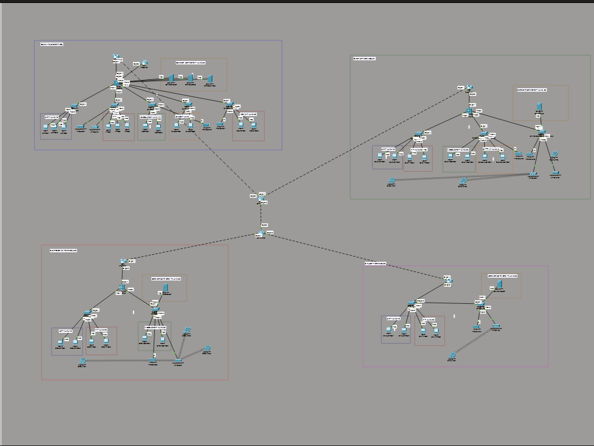
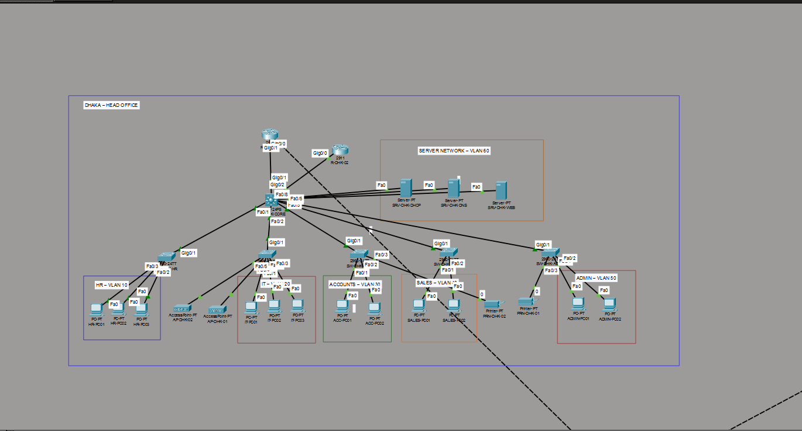
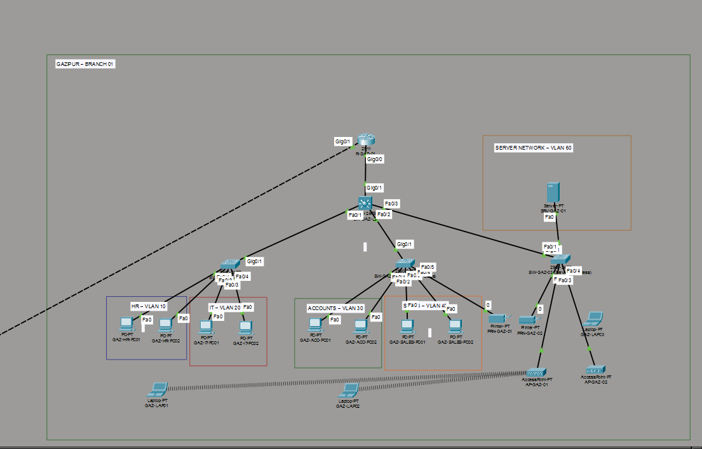
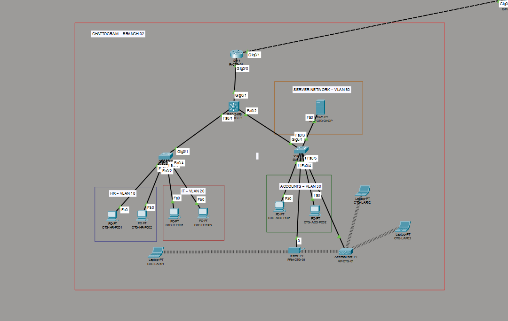
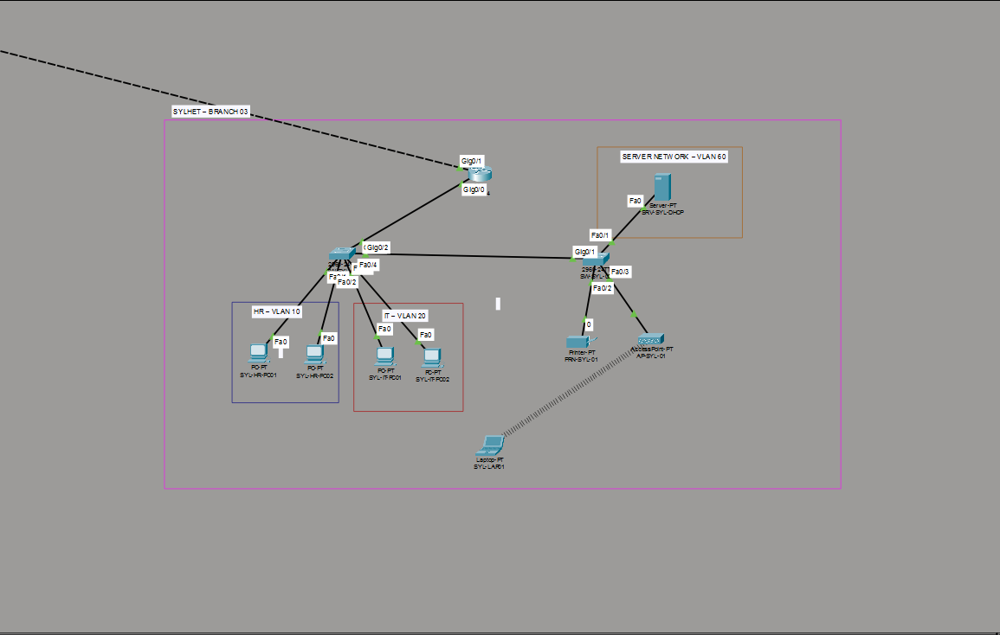
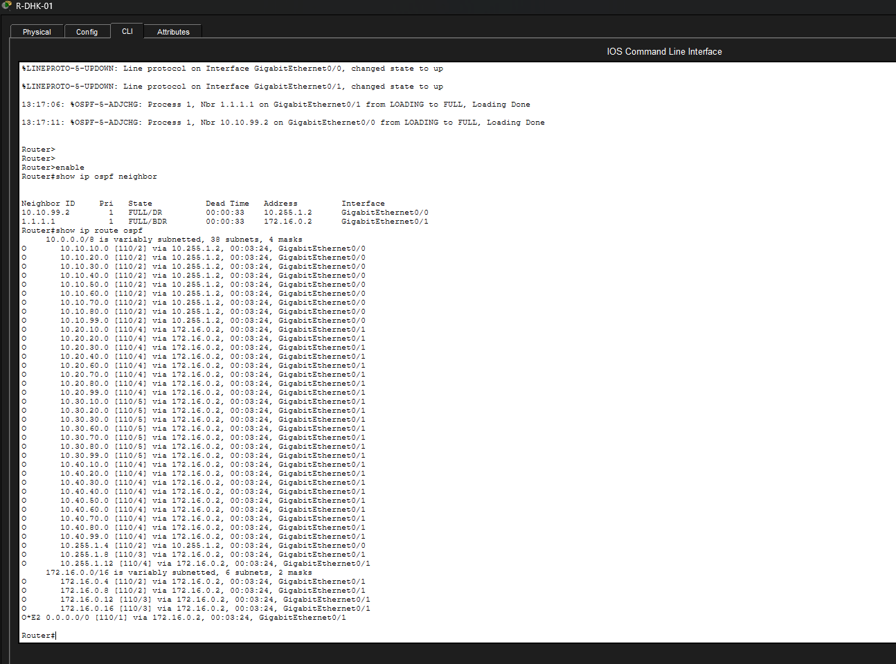
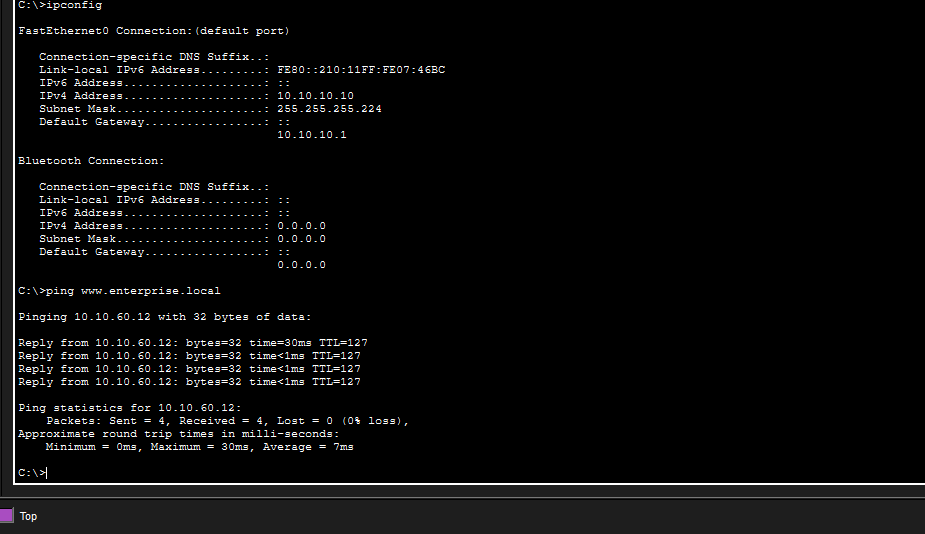
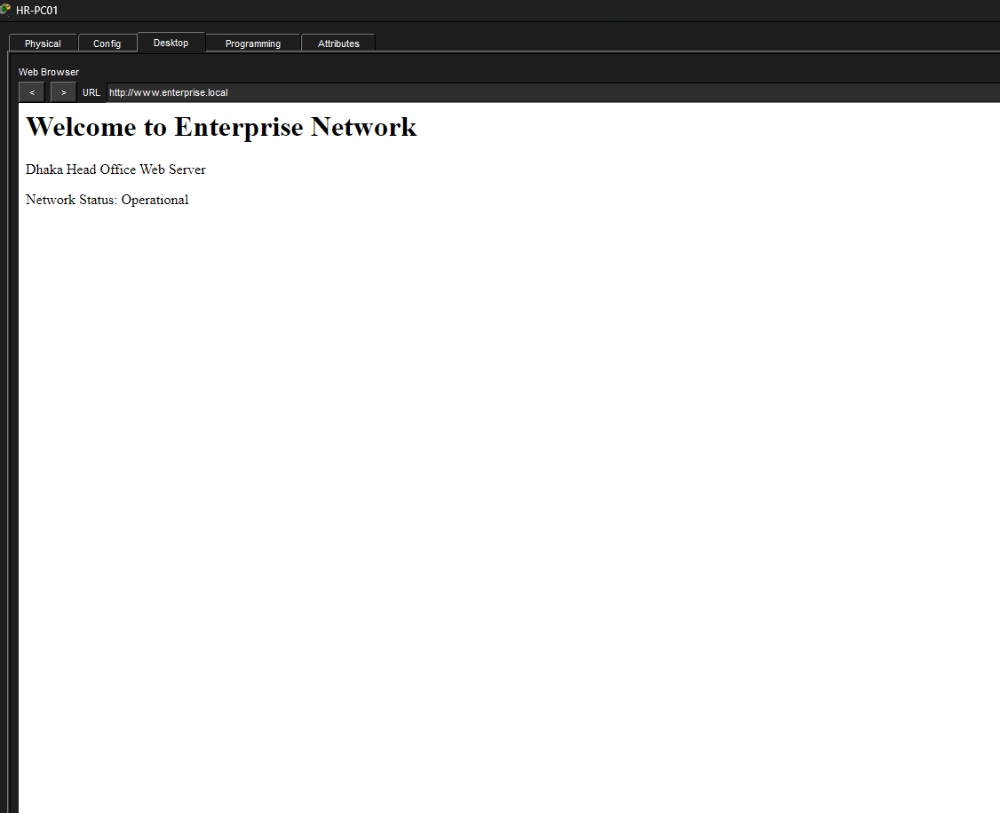

# Enterprise Multi-Branch Network Infrastructure

A multi-branch enterprise network infrastructure designed and simulated using **Cisco Packet Tracer**.

This project demonstrates practical networking concepts including VLAN segmentation, inter-branch connectivity, OSPF dynamic routing, DHCP, DNS, wireless networking, and internal web server configuration.

## Project Overview

The project simulates an enterprise network connecting four different locations in Bangladesh:

- **Dhaka** — Head Office
- **Gazipur** — Branch Office
- **Chattogram** — Branch Office
- **Sylhet** — Branch Office

The main objective is to design a structured, scalable, and manageable enterprise network that allows communication between departments and branch offices.

## Network Topology

## Branch Network Design

### 1. Dhaka Head Office

### 2. Gazipur Branch

### 3. Chattogram Branch

### 4. Sylhet Branch

## Technologies and Networking Concepts

| Technology | Purpose |
|---|---|
| Cisco Packet Tracer | Network simulation |
| VLAN | Network segmentation |
| Inter-VLAN Routing | Communication between VLANs |
| OSPF (Area 0) | Dynamic routing |
| DHCP | Automatic IP address assignment |
| DNS | Domain name resolution |
| HTTP Server | Internal website hosting |
| Wireless Networking | WiFi connectivity |
| Subnetting | IP address management |
| Management VLAN | Network device management |

## IP Addressing Plan

Each branch uses a separate private IP address block.

| Location | Network Address |
|---|---|
| Dhaka | `10.10.0.0/16` |
| Gazipur | `10.20.0.0/16` |
| Chattogram | `10.30.0.0/16` |
| Sylhet | `10.40.0.0/16` |

Detailed IP addressing documentation is available here:

[View IP Addressing Plan](Enterprise_Multi_Branch_IP_Addressing_Plan.docx)

## VLAN Configuration

The network uses VLANs to separate departments and infrastructure devices.

| VLAN ID | VLAN Name | Purpose |
|---|---|---|
| 10 | HR | Human Resources |
| 20 | IT | IT Department |
| 30 | ACCOUNTS | Accounts Department |
| 40 | SALES | Sales Department |
| 50 | ADMIN | Administration |
| 60 | SERVER | Server Network |
| 70 | WIFI | Wireless Network |
| 80 | PRINTER | Printer Network |
| 99 | MANAGEMENT | Network Management |

VLAN availability varies by branch.

## Routing and Network Services

### OSPF Dynamic Routing
- OSPF configured using Area 0.
- Dynamic route exchange between network routers.
- Inter-branch network connectivity.

### DHCP
- Automatic IP address assignment for supported end devices.
- DHCP configuration for branch networks.

### DNS
- Internal domain name resolution.
- Internal domain: `www.enterprise.local`

### Web Server
- Internal HTTP web server.
- Website accessible through the enterprise network.

### Wireless Networking
- WiFi connectivity for wireless clients.

## Network Verification and Testing

The following tests were performed in the Cisco Packet Tracer simulation.

### 1. OSPF Neighbor and Routing Verification

### 2. DHCP and DNS Testing

### 3. Internal Web Server Testing

**Internal Website:**

`http://www.enterprise.local`

### Additional Connectivity Tests

- Inter-branch connectivity
- PC-to-PC communication
- DHCP address assignment
- OSPF neighbor status
- Routing table verification
- DNS name resolution
- Internal website access
- Wireless client connectivity
- Printer connectivity

## Repository Files

| File | Description |
|---|---|
| [Packet Tracer Project (.pkt)](Enterprise%20Multi-Branch%20Network%20Infrastructure.pkt) | Complete simulated network and device configurations |
| [IP Addressing Plan (.docx)](Enterprise_Multi_Branch_IP_Addressing_Plan.docx) | Network design and IP addressing documentation |
| [Screenshots](Screenshots/) | Network topology and testing screenshots |

## How to Open the Project

1. Install Cisco Packet Tracer.
2. Clone or download this repository.
3. Open `Enterprise Multi-Branch Network Infrastructure.pkt`.
4. Explore the network topology and device configurations.
5. Test connectivity using PC Command Prompt and router CLI.

## Documentation Note

The IP Addressing Plan is a planning reference. Some addressing details and implementation choices may differ from the final Packet Tracer configuration.

The `.pkt` file represents the implemented simulation and should be used as the reference for actual device configurations.

## Learning Outcomes

Through this project, I gained practical experience in:

- Enterprise network design
- Multi-branch network architecture
- VLAN configuration and segmentation
- Routing and switching
- OSPF dynamic routing
- DHCP and DNS configuration
- Internal web server deployment
- Network troubleshooting
- Cisco Packet Tracer simulation

---

**Project Name:** Enterprise Multi-Branch Network Infrastructure

**Project Type:** Enterprise Network Simulation

**Simulation Tool:** Cisco Packet Tracer

**Routing Protocol:** OSPF (Area 0)

**Network Scope:** Four Branch Locations
